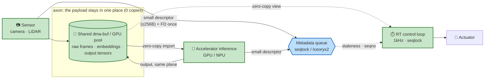
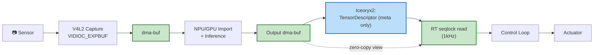

<!-- README.md (English) is the source of truth. When you change it, update README.ko.md in the SAME commit so the two stay in sync. -->

<p align="center">
  
</p>

# Axon — Data-Centric Zero-Copy for Physical AI

**English** | [한국어](README.ko.md)

> **One-liner**: Not another middleware on top of ROS2. We extend the **sensor → accelerator → RT control loop** path with end-to-end zero-copy that doesn't break, and a **bounded staleness that is measured and guaranteed**.

[]()
[](LICENSE)
[]()

> **Status**: working library + measured results. Core is built and tested (9/9); benchmarks, hardware verification, ROS1/ROS2 integration, a VLM handoff demo, and a cross-process GPU accelerator pool all land on this dev PC (RTX 5080). New here? See **[docs/usage.md](docs/usage.md)**, [Measured Results](#measured-results), and [docs/hardware-verification.md](docs/hardware-verification.md).

---

## Overview

**What.** `axon` keeps the tensor **payload in a shared dma-buf (or GPU allocation)** and lets every process and accelerator reference it *in place*. Only a fixed-size descriptor (≤256 B) crosses the queue; the buffer's FD is handed over once through an `SCM_RIGHTS` sidecar. In one line: **don't move the payload — leave it where it is and pass a reference.**

**Why.** Physical AI on a robot needs **high bandwidth, ultra-low latency, and RT determinism at the same time**, along the `sensor → accelerator → RT control` path. Standard middleware (ROS2 + DDS) copies each tensor several times per frame, so latency and CPU grow **with payload size** — exactly where robots move the most bytes (4K cameras, point clouds, image embeddings) — and staleness drifts with load, which makes it unusable in safety analysis. Message-level zero-copy (Iceoryx2) gets a message to RAM, but **putting it onto an accelerator copies again**, and the RT freshness guarantee is still missing. `axon` closes both gaps.

One picture says it: **green (the payload) stays in one place; only blue (small metadata) moves.**



Green = payload, referenced in place and never copied. Blue = the only thing that crosses the queue. (The concrete per-stage pipeline is in [Data Flow at a Glance](#data-flow-at-a-glance); the copy-heavy ROS2/DDS path it replaces is the 4-copy chain that path removes.)

**What you get** — the transport itself is **O(1) in payload size**: only the descriptor crosses, so the payload is written once, where the producer puts it, and never copied again on the way to a GPU or an RT loop. Measured on this dev PC:

### Headline results (measured, RTX 5080 / Ryzen 9800X3D vs ROS 2 Jazzy / Fast DDS)

| What | Result |
|---|---|
| GPU → GPU across processes, 4 MiB (vs ROS 2 loaned messages + data-sharing, C++) | **19× lower** latency (26 µs vs 485 µs) |
| GPU → GPU vs the GPU-sharing ROS 2 transports (official `rosidl::Buffer` CUDA backend, ros2_cuda_ipc) | With CUDA MPS: **~2× lower** at 1 MiB for a consumer that runs a kernel on the frame (≈23 vs 44-49 µs; 1.6× at 4 MiB), ~1.5-2× for one that copies results out. Without MPS: ~5× lower only for a copying consumer (≈25 vs ≈125 µs); a kernel consumer pays the ~100 µs switch between the processes' GPU contexts with axon too (129 vs 122-124 µs) |
| Across processes vs ROS 2 **inside one process** (intra-process `unique_ptr` / type adapter) | **not slower**: 4-5.5 µs faster with axon's consumer spinning against a `spin_some` loop (e.g. GPU 24 vs 28 µs), 1.3-2 µs faster with both consumers blocking (deep C-states off). Composing nodes into one process buys no latency over axon |
| 1 → 8 subscribers, GPU 1 MiB (event-driven consumers, deep C-states off) | **25 → 38 µs** vs 154 → 450 µs; producer and all subscribers together 0.021 vs 0.26 cores |
| Host → host vs other shared-memory transports (iceoryx2 0.10, Cyclone DDS + iceoryx, zenoh SHM), 64 B-64 MiB | **about the same as iceoryx2** up to 4 MiB (1 MiB: 15 vs 17 µs; Cyclone loaned 31, zenoh 125); **slower from 16 MiB** with its default 4-buffer ring (373 vs 219 µs with the clock held; DRAM traffic grows with ring depth, and 1 buffer matches iceoryx2). The host path is not where axon wins |
| Host → host, 1 MiB vs ROS 2 loaned + data-sharing (#43) | **2.4× lower** (15 µs vs 36 µs); 1.4× at 4 MiB |
| Multi-stream robot workload @ 297 MB/s (same comparison, event-driven consumer) | camera p50 **29 vs 44 µs**, **half the CPU** (0.019 vs 0.038 cores), 2.8× fewer cache-misses, every frame delivered |
| RT loop page faults | **0 / frame** |
| GPU cross-process share | **zero-copy**, 200/200 frames, 1.68 GB |
| VLM encoder→LLM handoff (video 34 MB) | **36× faster** than a host round-trip |
| Real camera → CUDA on a Jetson (AGX Xavier) | **0 copies**: the camera writes the buffer another process's CUDA reads |

Full detail in [Measured Results](#measured-results); the staleness guarantee is in [Target Metrics](#target-metrics--and-what-we-measured).

---

## Why axon — and how it differs from the alternatives

Zero-copy GPU sharing across processes is **not new** — it is built on standard
primitives (dma-buf, CUDA VMM, `__cuda_array_interface__`/DLPack), and mature
systems already do it. axon's bet is a **specific packaging** those systems don't
occupy:

- 🔌 **Framework- and vendor-neutral.** Not tied to GStreamer, ROS, or a fixed
  operator graph. It hands out a plain `device_ptr` / CUDA-array-interface, so the
  **same transport** feeds a PyTorch model *and* a hardware NVENC encoder —
  see [`examples/vla_demo/`](examples/vla_demo/) (DeiT-tiny → GPT-2, same GPU
  pointer both sides) and [`examples/nvenc_flywheel/`](examples/nvenc_flywheel/)
  (record straight from the shared GPU buffer).
- ⏱️ **Real-time latest-value-wins.** A seqlock plane with a **measured,
  formula-bounded staleness** and no back-pressure — built for a control loop that
  wants the *freshest* sample, where most alternatives optimise for a lossless
  queue.
- 🪶 **Thin and auditable** — a core you can read in an afternoon, not a multi-year
  framework.

**How it compares** (closest analogs — full analysis in
**[docs/positioning.md](docs/positioning.md)**):

| Solution | GPU zero-copy across procs | Coupling | Delivery model |
|---|---|---|---|
| **axon** | ✅ (CUDA VMM, ~25 µs GPU→GPU) | **none** — `device_ptr` / CAI | **latest-value-wins, bounded staleness** |
| ROS 2 `rosidl::Buffer` CUDA backend (Lyrical) | ✅ (~124 µs GPU→GPU, ~42 µs with MPS) | ROS 2 Lyrical+ | ROS pub/sub |
| ros2_cuda_ipc | ✅ (~125 µs GPU→GPU, ~37 µs with MPS) | ROS 2 | ROS pub/sub |
| NVIDIA Isaac ROS / NITROS | ✅ | ROS 2 + NVIDIA | ROS pub/sub |
| NVIDIA DeepStream | ✅ | GStreamer + NVIDIA | pipeline / queue |
| Iceoryx2 / eCAL | ❌ host SHM only | none | queue |
| ROS 2 + DDS | ❌ host SHM only | DDS / ROS | queue / history |

**Honest scope**: axon is pre-alpha and single-host; the NVIDIA frameworks are
production-grade, span nodes, and carry far more features. axon trades that breadth
for neutrality, RT-latest-value semantics, and a small core. Pick it when you want
one framework-neutral zero-copy transport on a single host for an RT consumer; pick
Isaac ROS / DeepStream / Holoscan when you want a batteries-included, vendor-backed
pipeline. Details and the decision guide: **[docs/positioning.md](docs/positioning.md)**.

---

## The Pitch (60 seconds)

ROS2 + Iceoryx2 integrations provide zero-copy at the **message middleware level**. A message can reach RAM zero-copy, but moving it onto an accelerator (NPU/GPU) typically requires another copy.

`axon` adds **two missing planes** on top of that:

1. **FD plane** — pass dma-buf FDs directly through a `SCM_RIGHTS` / `pidfd_getfd(2)` sidecar. The dma-buf exported by V4L2 capture is imported by the accelerator driver — **no host memory copy**.
2. **Time plane** — inference runs in a non-RT worker; the RT control loop reads results via a seqlock as a zero-copy view. The staleness bound is computed by an **explicit formula** (7 terms) and is therefore directly usable in safety analysis.

---

## Data Flow at a Glance



Green = zero-copy region. Blue = metadata message. Twelve more diagrams in [`DesignFiles/diagrams.md`](DesignFiles/diagrams.md).

---

## Target Metrics — and what we measured

Measured on a workstation (RTX 5080 / Ryzen 9800X3D, non-RT kernel) against ROS2 Jazzy /
Fast-RTPS on the same workload. Full detail: [docs/hardware-verification.md](docs/hardware-verification.md).

| Metric | Target | Measured (axon vs ROS2) |
|---|---|---|
| Latency vs ROS 2's zero-copy path (C++, loaned messages + data-sharing) | low | **host 1 MiB: 15 vs 36 µs (2.4×); GPU→GPU 4 MiB: 26 vs 485 µs (19×); multi-stream camera p50 29 vs 44 µs** ✅ |
| CPU at 297 MB/s (multi-stream, C++, vs ROS 2 zero-copy) | low | **0.019 vs 0.038 cores event-driven (0.015 in a 1 kHz loop)** — both under 0.1 core ✅ |
| Frame delivery under load (C++) | no drops | **100 % on every camera stream for every transport** (ROS 2 needs a Fast DDS SHM segment larger than a frame; the benchmark refuses to run without one) ✅ |
| Memory cost (same workload, C++, vs ROS 2 zero-copy) | 0 payload copies | **cache-misses 2.8× lower event-driven, 4.2× in a 1 kHz loop; ~0 transport syscalls/frame** ✅ |
| Page faults during RT | **0** | **0 / frame** (flat at 20× the frames) ✅ |
| GPU zero-copy import | real hardware | **RTX 5080: 200/200 frames, 0 copies, 1.68 GB** ✅ |
| Sensor → accelerator, no copy | real board + real sensor | **AGX Xavier + UVC webcam: host == CUDA view on 30/30 frames, staleness ~0.5 ms** ✅ |
| Staleness bound | sum of 7 explicit terms | deterministic formula (§5) ✅ |
| 1kHz RT worst-case jitter | < 100µs | stock Jetson kernel 1.26 ms (baseline); PREEMPT_RT run pending 🟡 |

The formula:
```
worst_case_staleness ≤ 
    T_cap + T_fence_p + T_inf + T_pub
  + T_sc + T_rt_seq + T_view
```
[Definition](DesignFiles/detailed_design_doc.md#5-bounded-staleness-formula) | [Visualization](DesignFiles/diagrams.md#9-bounded-staleness--visualized)

---

## Measured Results

The thesis is that the transport is **O(1) in payload size**: only fixed-size descriptors
cross the metadata plane while the tensor stays in a shared dma-buf, so the payload is written
once and never copied on the way.

**The multi-stream robot workload, in C++** ([`benchmarks/ros2_cpp`](benchmarks/ros2_cpp/README.md#multi-stream-cpu-latency-delivery-and-cache-misses)):
four cameras plus LiDAR, IMU and odometry, scaled to 297 MB/s; ROS 2 in its event-driven executor, axon either in a
1 kHz loop or blocking in `TensorSubscriber::wait_any` (event-driven, [docs/usage.md](docs/usage.md#event-driven-consumer-wake-on-publish)).

| at 297 MB/s (median of 3) | rclcpp `UInt8MultiArray` | ROS 2 zero-copy | axon, 1 kHz loop | axon, `wait_any` |
|---|---|---|---|---|
| CPU, producer + consumer | 0.077 cores | 0.038 cores | **0.015 cores** | 0.019 cores |
| camera p50 / p99 latency | 103 / 334 µs | 44 / 235 µs | 557 / 1017 µs | **29 / 124 µs** |
| cache-misses / instructions per second | 15.6 M / 0.219 B | 3.66 M / 0.127 B | **0.87 M / 0.024 B** | 1.31 M / 0.040 B |
| camera-stream delivery | 100 % | 100 % | 100 % | 100 % |

In C++ every transport is cheap, so the CPU gap is real but small in absolute terms. Event-driven, axon has the lowest
latency for half the CPU of ROS 2's zero-copy path; the 1 kHz loop is cheaper still but makes a frame wait half a tick.
The rclpy sweep below (0.30 vs 0.98 cores) is almost all Python:


**Against ROS 2's own zero-copy path, in C++** ([`benchmarks/ros2_cpp`](benchmarks/ros2_cpp/README.md)). The plots above and below compare with rclpy (Python), and most of that gap is Python. Redone in rclcpp, against loaned messages + Fast DDS data-sharing (p50, µs, median of 3 runs):

| payload | host → host: ROS 2 zero-copy / axon | GPU → GPU: ROS 2 zero-copy / axon |
|---|---|---|
| 147 KiB | 25 / **4** | 50 / **24** |
| 1 MiB | 36 / **15** | 171 / **25** |
| 4 MiB | 80 / **59** | 485 / **26** |

On the host, ROS 2's zero-copy path is close: both copy the payload once into shared memory, and axon saves a fixed ~20 µs per message. On the GPU, a ROS 2 message lives in host memory, so the payload goes D2H and H2D around the transport; axon hands over the device buffer itself and stays at 24-26 µs at any size. Default Fast DDS does **not** take the zero-copy path for these sizes: it needs the XML profile in that directory.

**Single-stream latency vs rclpy** ([`benchmarks/`](benchmarks/)):


**Copies aren't free** — same delivered bytes, kernel-measured ([docs/hardware-verification.md](docs/hardware-verification.md)):


ROS2 (rclpy) spends **8.6× the cache-misses** and **5× the instructions** moving the same data; in C++ against ROS 2's zero-copy path, counted over the same measured window, the gap is 4.2× and 5.3× (axon's 1 kHz loop).

**Real GPU zero-copy without a robot board.** axon's FD sidecar carries a live RTX 5080 GPU
memory handle across processes: 200/200 frames validated on-GPU, **0 host payload copies**,
1.68 GB moved zero-copy. Plus RT page-faults measured at **0 per frame**. See
[docs/hardware-verification.md](docs/hardware-verification.md) and the architecture decisions
in [docs/adr/](docs/adr/).

**On a real Jetson with a real camera.** On an AGX Xavier (JetPack 5.1.6) with a UVC webcam,
the camera captures straight into an axon `NvBufSurface` pool, and a second process receives
the same frame as a host view **and** a CUDA device pointer — no copy anywhere on the path.

| Check (AGX Xavier, 640×480 YUYV) | Result |
|---|---|
| Camera writes into the pool (`V4L2_MEMORY_DMABUF`) | ✅ 3/3 probe runs |
| Other process: CUDA view == host view | ✅ **30/30** frames (probe), **4/4** checks (demo) |
| GPU write by the consumer seen by the producer | ✅ same physical memory |
| Staleness, camera frame → consumer | **~0.5 ms** (incl. a 1 ms poll sleep) |
| Library tests on the board | **9/9** ctest, `test_nvbuf_pool` 10/10 reruns |

Reproduce with [`examples/jetson_camera/`](examples/jetson_camera/README.md); every step is in
[docs/hardware-verification.md §6](docs/hardware-verification.md#6-jetson--camera--cuda-zero-copy-via-nvbufsurface-agx-xavier-).

> Numbers are machine-specific — reproduce with `benchmarks/mock/mock_compare.py` and the
> `instrumentation/` suite (all resource-bounded so they won't freeze the box).

---

## 30-Second Demo (work in progress)

```
[ TODO: 30-second video — closed-loop mini demo ]
[ V4L2 camera → NPU inference → 1kHz RT control loop ]
[ Live overlay of the metrics above ]
```

Closed-loop video demo pending a real sensor + robot board; the GPU/RT data path it exercises is already measured on this dev PC (see [Measured Results](#measured-results)).

---

## Quick Build

The full library, examples, Python bindings, benchmarks, and hardware-instrumentation
suite build today:

```bash
cmake -S . -B build -DCMAKE_BUILD_TYPE=Release -DAXON_BUILD_PYTHON=ON
cmake --build build -j
(cd build && ctest --output-on-failure)      # 9/9, warning-clean

# axon vs ROS2 benchmarks (ROS2 optional)
python3 benchmarks/mock/mock_compare.py --scales 1,2,3,4 --seconds 5
# real-hardware verification (GPU / page-faults / syscalls / cache)
instrumentation/gpu/build.sh && instrumentation/run_bounded.sh ./build/gpu_sidecar_demo 8 200
```

New here? Start with **[docs/usage.md](docs/usage.md)** — copy-paste producer/consumer,
RT loop, Python, and GPU examples, each mapped to a tested demo.

Optional feature flags (all default off — the core stays dependency-free):
- `-DAXON_WITH_ICEORYX2=ON` — Iceoryx2 metadata backend ([docs/metadata-backends.md](docs/metadata-backends.md)).
- `-DAXON_WITH_CUDA=ON` — `PoolBackend::Accelerator` CUDA VMM device pool for cross-process GPU zero-copy ([docs/usage.md §4](docs/usage.md#4-cross-process-gpu-zero-copy-accelerator-pool-r6)).
- `-DAXON_ENABLE_JETSON=ON` — `PoolBackend::NvBufSurface` Jetson pool: camera → host view + CUDA view, no copy ([docs/usage.md §5](docs/usage.md#5-jetson-camera--cuda-zero-copy-nvbufsurface-pool)).

### Prerequisites

- Linux + PREEMPT_RT-patched kernel (only required for RT validation. The spike PoC alone runs on a stock kernel.)
- A V4L2-compatible camera (a USB UVC camera works)
- One accelerator board:
  - **AMD AI Series** (XDNA NPU) — XDNA driver, ROCm 6.x+
  - **NVIDIA Jetson** — JetPack 5.x+ (verified: AGX Xavier, JetPack 5.1.6 / CUDA 11.4)
- gcc 11+, cmake 3.22+

### Spike PoC Build (week 1-2 validation)

```bash
# Build both producer and consumer
cmake -S examples/spike_poc -B build/spike -DCMAKE_BUILD_TYPE=Release
cmake --build build/spike -j

# Run (one terminal)
./build/spike/axon_spike_producer /dev/video0

# Other terminal
./build/spike/axon_spike_consumer
```

What the PoC validates:
- ✅ V4L2 capture → `VIDIOC_EXPBUF` exports a dma-buf FD
- ✅ `SCM_RIGHTS` delivers the dma-buf FD across processes
- ✅ The received FD is mmap'd as a zero-copy host view (eBPF-verified)
- ✅ Accelerator import — NVIDIA Jetson via NvBufSurface ([examples/jetson_camera](examples/jetson_camera/README.md)); AMD XDNA not yet

[Spike guide](examples/spike_poc/README.md) | [Spike decision tree](DesignFiles/diagrams.md#12-week-1-2-spike-poc-decision-tree)

---

## API at a glance

The library is implemented and tested — not a skeleton. Full runnable examples
(producer/consumer, RT loop, Python, GPU) are in **[docs/usage.md](docs/usage.md)**;
here is the shape of it.

```cpp
#include <axon/publisher.h>
#include <axon/subscriber.h>
#include <axon/pool.h>

// Producer side (non-RT)
auto pool = axon::TensorPool::create({
    .n_buffers   = 32,
    .buffer_size = 4 * 1024 * 1024,
    .backend     = axon::PoolBackend::Custom,   // Custom/UDMABUF/V4L2/Accelerator
    .v4l2_device = nullptr,
});
auto pub = axon::TensorPublisher::create("camera/inference_out", *pool);
pub->handshake_pool();  // SCM_RIGHTS bulk transfer

while (running) {
    axon::AcquiredDescriptor a = pub->acquire_descriptor();
    // ... write the frame straight into a.host_view, stamp a.desc ...
    pub->publish(std::move(a));
}

// Consumer side (RT 1kHz loop)
auto sub = axon::TensorSubscriber::create("camera/inference_out");
sub->wait_handshake();
sub->set_fallback_policy(axon::FallbackPolicy::LastKnownGood);

axon::rt_setup_memory_and_sched();  // mlockall + prefault + SCHED_FIFO

while (rt_tick()) {
    auto view = sub->latest_view(/*max_retry=*/8);
    if (view) {
        process(view->data, view->shape);
        log_staleness(view->staleness_ns);
    }
    // fallback is applied internally by sub
}
```

[Usage & examples](docs/usage.md) | [Full API headers](include/axon/) | [`TensorDescriptor` definition](DesignFiles/detailed_design_doc.md#112-tensordescriptor-definition-iceoryx2-payload)

---

## FAQ

**Q. ROS2 + Iceoryx2 integrations already exist. Why another?**
A. `rmw_iceoryx_cpp` and Iceoryx2's ROS2 integration give zero-copy at the **message middleware level**. axon adds the **dma-buf FD sidecar + accelerator import integration layer** on top, so zero-copy is unbroken from sensor through accelerator and into the RT control loop. [Differentiation in detail](DesignFiles/data-centric-zero-copy-design-20260510.md#premises-agreed)

**Q. Can dma-buf FDs be sent through Iceoryx2 SHM?**
A. No. Writing an integer FD into shared memory means nothing in another process — FD tables are per-process. Cross-process FD transfer requires `SCM_RIGHTS` or `pidfd_getfd(2)`. [Sidecar handshake sequence](DesignFiles/diagrams.md#3-fd-handshake-sequence)

**Q. Does the RT loop call NPU inference directly?**
A. No. NPU inference latency has a long tail through P99.99 and is affected by thermal throttling — it cannot be bounded deterministically. axon runs inference in a non-RT worker; the RT loop reads only the **most recent inference result with a measured/guaranteed staleness bound**, as a zero-copy view via seqlock. [RT pattern](DesignFiles/detailed_design_doc.md#33-rt-consumer-pattern-seqlock)

**Q. Which platform is the first build target?**
A. Decided during the week 1-2 spike PoC. Candidates: **AMD AI Series (XDNA)** and **NVIDIA Jetson Orin**. Apple Silicon is **out of scope for the first build** because macOS lacks V4L2 and Asahi Linux lacks an ANE driver. [Decision tree](DesignFiles/diagrams.md#12-week-1-2-spike-poc-decision-tree)

**Q. Multi-host (distributed) support?**
A. The first build is single-host multi-process only. Multi-host is Phase 4 (zenoh integration or Iceoryx2 distributed mode). [Evolution path](DesignFiles/diagrams.md#11-evolution-path--phase-1--phase-4)

**Q. Can ROS2 users adopt this?**
A. Yes — Phase 3 ships a ROS2 RMW backend (Approach C). The Phase 1 core is a minimal library with no ROS2 dependency, so ROS2 users can adopt it via a thin wrapper.

**Q. License?**
A. Apache 2.0 (with patent grant — friendlier for robotics industry adoption).

---

## Reproducible Benchmark Environment

The current README graphs were measured on a workstation (numbers are machine-specific):

```
- Host: AMD Ryzen 7 9800X3D (16 threads), NVIDIA RTX 5080, 80 GB RAM
- Kernel: Linux 6.17 (non-RT) — 1kHz jitter target pending a PREEMPT_RT kernel
- Middleware: ROS2 Jazzy / Fast-RTPS (default DDS), Iceoryx2 v0.9.2
- Payloads: synthetic tensors; serving-robot multi-stream profile (benchmarks/mock)
- Runner: all under instrumentation/run_bounded.sh (resource-bounded)
```

Full method + raw numbers: [docs/hardware-verification.md](docs/hardware-verification.md).

---

## Design Document Tree

| Document | Role |
|---|---|
| [`docs/usage.md`](docs/usage.md) | **Usage & examples** — copy-paste C++/Python/GPU snippets, each mapped to a tested demo |
| [`DesignFiles/data-centric-zero-copy-design-20260510.md`](DesignFiles/data-centric-zero-copy-design-20260510.md) | Direction, differentiation, risk/mitigation (APPROVED v2) |
| [`DesignFiles/detailed_design_doc.md`](DesignFiles/detailed_design_doc.md) | Mechanism details (14 sections, ~700 lines) |
| [`DesignFiles/diagrams.md`](DesignFiles/diagrams.md) | 12 Mermaid diagrams |
| [`docs/adr/`](docs/adr/) | Architecture Decision Records (why, with measured evidence) |
| [`docs/hardware-verification.md`](docs/hardware-verification.md) | Measured results (GPU zero-copy, page-faults, syscalls, cache) |
| [`docs/metadata-backends.md`](docs/metadata-backends.md) | Seqlock vs Iceoryx2 backend |
| `examples/spike_poc/README.md` | Week 1-2 spike PoC guide |

---

## Roadmap

Design → working library + measured results. Done (merged to `main`):

- [x] Design doc v2, mechanism detail (~700 lines), 12 Mermaid diagrams
- [x] Spike PoC — V4L2 `VIDIOC_EXPBUF` → `SCM_RIGHTS` → mmap'd zero-copy view
- [x] Core library — sidecar (FD plane) + seqlock metadata + dma-buf pool + RT helpers + pub/sub
- [x] Python bindings (zero-copy NumPy)
- [x] Iceoryx2 lock-free SHM metadata backend (`AXON_WITH_ICEORYX2`)
- [x] ROS2 single-stream + multi-stream (MockSystem) benchmarks
- [x] Hardware verification on RTX 5080 — GPU zero-copy, page-faults, syscalls, perf/cache
- [x] ROS1 integration — descriptor-topic offload (M1) **+ drop-in `axon` `image_transport` plugin (M2)**, on a reusable ROS-agnostic `axon_bridge` (Docker-verified: 232/232 frames, 0 payload copies)
- [x] **ROS2 integration** — descriptor-topic offload on the *same* `axon_bridge`, native ROS2 Jazzy (`integrations/ros2_offload/`): payload stays in the dma-buf, only the descriptor rides DDS, with per-message bounded staleness (mean ~160 µs). 90/90 frames, 0 payload copies
- [x] Depth wire v2 (row_pitch / depth_scale / intrinsics) + validation
- [x] VLM encoder→LLM handoff benchmark (up to 36×)
- [x] **R6 accelerator pool** — `PoolBackend::Accelerator` CUDA VMM device zero-copy (`AXON_WITH_CUDA`)
- [x] **R2 sync-fence** — `sync_file` fence surfaced in `latest_view` for producer→consumer ordering; non-RT `drain_fences()` keeps the RT read syscall-free (fence-gated frame skipped until its fence arrives)
- [x] **Direction A — vision→LLM zero-copy** — framework tensor ↔ axon GPU buffer via `__cuda_array_interface__` on both the producer (`device_array`) and the consumer (`latest_view`), plus consumer-side CUDA VMM import. Working two-process demo (`examples/vla_demo/`: DeiT-tiny → axon → GPT-2 prefill, same GPU pointer both sides, no host copy)
- [x] **Jetson NvBufSurface backend** — `PoolBackend::NvBufSurface` (`AXON_ENABLE_JETSON`): a UVC camera captures straight into the pool and another process gets the frame as a host view **and** a CUDA pointer, no copy. Verified on AGX Xavier with a real webcam (`examples/jetson_camera/`, host==device 4/4, staleness ~0.5 ms)
- [x] **Direction D — NVENC data flywheel** — record the stream to disk straight from the shared GPU buffer: the recorder feeds each `latest_view()` to hardware NVENC with no host copy (`examples/nvenc_flywheel/`, decode-verified H.264)
- [x] **Fair C++ benchmark against ROS 2's zero-copy path** — rclcpp, loaned messages + Fast DDS data-sharing, host and GPU (`benchmarks/ros2_cpp/`): host 1 MiB 15 vs 36 µs, GPU→GPU 4 MiB 26 vs 485 µs; multi-stream at 297 MB/s camera p50 29 vs 44 µs for 0.019 vs 0.038 cores
- [x] **Event-driven consumer** — `TensorSubscriber::wait_for_update` / `wait_any` block on a futex in the metadata slot (`futex_waitv` for several streams); the publisher pays a `FUTEX_WAKE` only while someone waits, so `publish()` stays syscall-free for RT producers
- [x] **No silent drops** — `publish()` returns -1 with `EMSGSIZE`/`EINVAL` for a descriptor that does not fit (and spends no seqno), `TensorPublisher::create()` refuses import params a handshake cannot carry (`E2BIG`), and the Python bindings raise

Next:

- [ ] `cyclictest` 1 kHz jitter on a PREEMPT_RT kernel (needs the target board)
- [ ] AMD XDNA backend + real robot integration

---

## Contributing

Working library, pre-alpha and moving fast. Issues, discussions, and PRs are welcome. The core has zero required dependencies and builds/tests green (9/9) on a stock Linux box — see [docs/usage.md](docs/usage.md) to get started.

> **Docs are bilingual.** `README.md` (English) is the source of truth; `README.ko.md` (한국어) mirrors it. Edit **both in the same commit** when you change either.

## License

Apache 2.0 — see [LICENSE](LICENSE)
